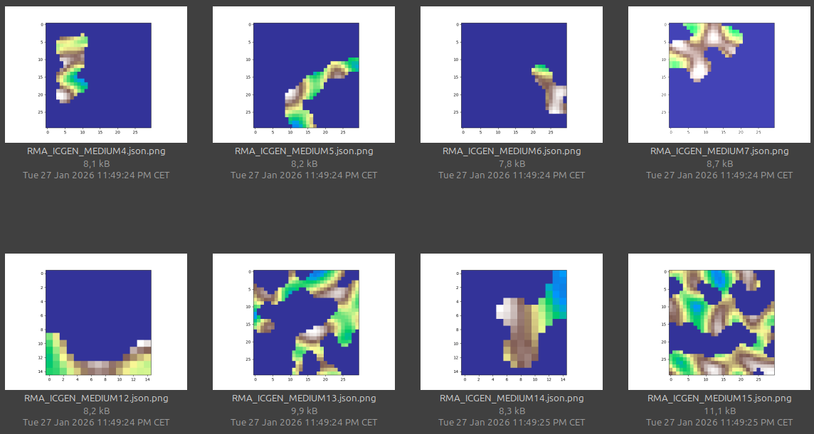

# Procedural cave generation for Deep Rock Galactic

A Python program that generates randomized caves for the game Deep Rock Galactic based on the following:

1. A cellular automata generates a 2D tile map based on some user settings (see `settings/settings.json`).
2. A randomized heightmap made with simplex noise is imposed on the generated map. 
3. The maximally inscribed circles are calculated for each map. 
4. An adjacency graph and its traversal path are calculated for each map. 
5. Entrances and exits are poisitioned on some of the circles chosen at random, with the positions computed with a most free angle algorithm.

The result is a json defining a room that can be input into the [DRG room editor](https://github.com/vonacht/drg-room-editor/) to generate the corresponding UAssets.

